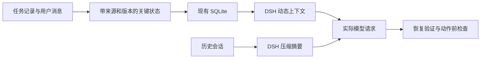

# dsh-superagent 上下文管理改进方案

日期：2026-11-04

状态：待实施方案，已完成 GitHub 调研及本地接口核查。当前实例的兼容性、压缩恢复效果和长会话表现尚待实测。

目标项目：`C:/Users/Admin/src/dsh-superagent`

优先解决压缩后关键任务状态的恢复和验证，再完善上下文预算，最后接入跨任务长期记忆。第一阶段复用现有 DSH、SQLite、Engine 和任务资源读取接口，新增业务状态契约、动态上下文接入及专项测试。

## 1 现状与改进目标

当前项目已有独立任务会话、摘要卡片、按需展开原文、DSH 压缩与工具结果剪枝，以及重启后的消息恢复机制。需要补齐三个方面：

1. 压缩后能否准确恢复最新目标、有效约束、用户纠正、未完成事项和外部动作结果，并提供实际验证。
2. 应用层上下文预算及效果指标，包括不同内容的 token 占比、恢复正确性和重复读取量。
3. 跨任务知识的提取、检索、适用范围、失效与冲突处理。

DSH 官方文档已经描述动态上下文快照在发生变化或被压缩移除时重新加入模型历史的机制；本地依赖也包含 `systemPrompt.context()` 接口。因此，第一项缺口主要在业务关键状态的接入和验收，底层恢复机制已有可复用基础。具体时序必须以项目锁定版本的实际请求验证为准。[DSH 系统提示词组装](https://github.com/deepseek-ai/deepseek-harness/blob/master/docs/subsystems/system-prompt.md)

## 2 GitHub 调研与复用决策

以下 Star 为 2026-11-04 检索页面显示的近似值，只作社区规模参考。维护状态依据当时的发布页与源码；实际引入依赖时需要固定版本和核对许可证。

| 方案 | 社区与维护证据 | 可复用能力 | 本项目决策 |
| --- | --- | --- | --- |
| [Deep Agents JS](https://github.com/langchain-ai/deepagentsjs) | 约 1.6k Star，MIT；[近期有发布](https://github.com/langchain-ai/deepagentsjs/releases) | 历史外置、摘要保留原文入口、按模型窗口设置预算 | 借鉴实现和测试方式；middleware 依赖 LangChain，不直接接入当前 DSH 执行链 |
| [LangGraph](https://github.com/langchain-ai/langgraph) | 约 44.4k Star，MIT；[持续发布](https://github.com/langchain-ai/langgraph/releases) | 线程检查点、恢复、任务状态与跨任务记忆分开存储 | 借鉴检查点语义，继续使用现有 SQLite 和 Engine |
| [Letta](https://github.com/letta-ai/letta) | 约 25.3k Star，Apache-2.0；[公开发布节奏较前两项慢](https://github.com/letta-ai/letta/releases) | 关键记忆常驻，其他资料按需读取 | 借鉴分层方式；引入整个平台成本偏高 |
| [Mem0](https://github.com/mem0ai/mem0) | 约 68.4k Star，Apache-2.0；已有 [DSH 插件 0.3.2](https://github.com/mem0ai/mem0/releases/tag/deepseek-plugin-v0.3.2) | 长期事实提取、检索、去重和原生 Cordis 接入 | 第三阶段优先候选，先验证兼容性、消息来源匹配与隔离 |

本次没有发现可直接接入当前项目、同时完成三项目标并保证关键业务状态恢复正确的成熟整包。直接复用 DSH 动态上下文与压缩机制，在现有业务存储上补充状态契约，成本和适配范围更可控。这是基于当前架构的选型判断。

LangGraph 将线程检查点与跨线程 Store 分开；Letta 将每轮进入上下文的核心记忆与按需读取的其他资料分开。这两种设计可用于明确本项目任务状态与长期知识的职责。[LangGraph 持久化](https://docs.langchain.com/oss/javascript/langgraph/persistence)、[Letta 记忆](https://docs.letta.com/agent-sdk/memory)

## 3 第一阶段 关键任务状态恢复与验证

### 3.1 目标与结构

即使历史摘要遗漏信息，Agent 下一次执行前仍能获得最新目标、有效约束、未完成事项和已执行动作的证据。

### 3.2 先验证当前 DSH 版本的恢复接口

使用项目锁定版本构造带动态上下文的会话，主动压缩，再检查下一次模型请求。分别覆盖普通压缩、上下文溢出重试和进程恢复，确认关键上下文出现的实际时机。

本地依赖类型已有 `systemPrompt.context()`。官方文档描述了动态上下文刷新和压缩后的补回；文档主分支可能比本地版本新，不能仅凭文档认定现场已生效。[DSH 动态上下文接口](https://github.com/deepseek-ai/deepseek-harness/blob/master/packages/core/system-prompt/README.md)

本步骤交付：锁定的 DSH 版本、最小可复现用例、压缩前后请求证据及兼容性结论。

### 3.3 结构化任务关键状态

在现有 Store 中保存所需状态，由 Engine 统一管理业务更新，延续现有单一写入者设计。

| 内容 | 保存和生成规则 |
| --- | --- |
| 当前目标、验收标准、授权范围 | 引用 Ticket、Mandate 和原始请求 |
| 用户最新纠正、有效约束 | 保存原文引用、消息 ID、生效版本和替代关系 |
| 已完成事项 | 区分 Agent 报告完成与有验证证据的完成；关联提交或结果 |
| 未完成事项、阻塞和待决定问题 | 结构化列表，保留状态与来源 |
| 外部动作结果 | 引用现有回执；结果不明的动作标为待核对 |
| 恢复元信息 | `ticketId`、`assignmentId`、状态版本、已处理输入位置、内容摘要值 |

可以由现有记录计算的内容直接生成，避免保存第二份易失步的业务事实。需要从自然语言提取的内容必须附来源；新消息未完成提取时，保留原文和未处理标记，不能直接视为已吸收。

较新的消息不能只凭时间自动覆盖旧约束。替代关系必须有明确依据；无法确定时保留冲突或待处理状态。模型生成的总结不改变 Mandate，也不授予额外权限。

状态更新需要检查基准版本，防止较旧提取结果覆盖新消息。状态内容及已处理输入位置应一起提交；实现时复用现有事务能力。

### 3.4 接入任务级动态上下文

使用 `agent.ctx.systemPrompt.context()` 注册任务上下文，由 Store 当前状态生成，设置 `required: true` 和 `interpolate: false`。

- 主会话获得待办索引及路由所需状态。
- 执行会话获得自己任务的完整关键状态。
- 历史详情通过现有资源接口按需读取，继续执行 Ticket 读取范围限制。
- 关键状态保持精简；若有效约束超过预算，应明确暴露容量问题，不能静默截断。
- 使用版本和内容摘要值支持去重及请求核查；是否进入请求以实际证据为准。

当前主会话在 `src/app/sessions.ts` 使用 `complete: true` 的完整系统提示词。新增内容应走独立动态 context，避免普通 prompt section 被完整提示词覆盖。

`required: true` 表示关闭可选运行时上下文时仍保留该项；它本身不能替代压缩恢复测试或保证模型遵守所有约束。

### 3.5 验证实际请求与后续动作

每次恢复记录任务状态版本、输入位置，以及实际模型请求中包含的状态版本。收到压缩完成事件、登记了 provider、数据库中存在状态，或模型回复已理解，均不能单独证明恢复正确。

对已有受控工具检查任务身份、状态版本和授权范围。状态过期时重新加载；结果不明的外部动作先查询实际结果，再决定是否重试。复用已有回执和幂等机制。

任意 Shell 命令不因引入关键状态就获得绝不重复执行的保证。第一阶段应明确受控工具和外部动作的覆盖范围，未覆盖的命令保留执行前核查要求。

### 3.6 专项验收

| 场景 | 验收要求 |
| --- | --- |
| 原始目标已被压缩 | 下一次实际模型请求包含当前目标和验收条件 |
| 用户纠正旧方案后再压缩 | 有效状态体现新决定，旧决定标明已替代 |
| 压缩期间收到新消息 | 新消息被保留，不被旧快照覆盖 |
| 连续多次压缩、压缩后重启 | 状态版本可追踪，未完成事项不丢失 |
| 请求取消后重试 | 未真正送达的内容仍可再次提供 |
| 多个 Ticket 同时运行 | 不串任务状态，不扩大读取范围 |
| 外部操作成功但回执不明 | 进入结果核对流程，不盲目重做 |
| 状态损坏或有效约束超预算 | 明确暴露异常，不带着残缺状态继续相关动作 |

验证分两层：

1. 确定性测试检查数据版本、实际请求内容、重试去重及任务隔离。
2. 真实模型固定任务集检查用户纠正是否被遵守、后续动作是否合理。覆盖主会话和执行会话，并对比压缩前后的表现。

第一阶段目标：固定测试集中的关键字段恢复全部通过，受控测试中的越权和重复外部动作均为零。这是待验证的验收标准，不代表对所有未来任务的保证。

## 4 第二阶段 上下文预算与观测

复用 DSH token 计量及压缩策略。官方实现支持模型级阈值、输出余量和近期历史保留配置；项目中采用哪些参数，应以实际安装版本支持范围为准。[DSH 压缩配置](https://github.com/deepseek-ai/deepseek-harness/blob/master/packages/compaction/compaction-basic/README.md)

内容优先级为：有效约束与当前请求、当前工作所需证据、历史摘要、可选长期记忆。预算扣除工具定义、输出预留和安全余量，模型变化时重新计算。

大型日志和历史正文保留原文入口，按需分页，不反复整体塞入请求。Deep Agents 的历史外置及摘要实现可作为设计和测试参考。[Deep Agents JS 源码](https://github.com/langchain-ai/deepagentsjs/blob/main/libs/deepagents/src/middleware/summarization.ts)

先记录以下基线，再调整阈值：

- 各类上下文 token 占比及估算方式。
- 压缩次数。
- 恢复状态版本不一致次数。
- 重复读取量。
- 固定任务集的约束遵守率。

验收需要同时比较资源消耗和任务正确性。不能只凭 token 减少认定优化成功；不得通过丢弃有效约束实现预算目标。

## 5 第三阶段 长期记忆

优先验证 Mem0 的可复用范围。长期记忆提供历史知识，任务当前状态继续由本地 Store 管理。

### 5.1 已识别的适配条件

1. 插件自动路径按 `userId` 跨会话共享，自动写入不附仓库 ID。需要明确仓库、任务和共享知识范围，防止跨项目混入。
2. 当前插件连接 Mem0 Platform；不能仅修改地址就把它接到 Mem0 OSS API。若选择自托管 OSS，需要另行验证 SDK 或适配器接入方式。
3. 插件自动召回筛选 `source.kind === "user"`；本项目任务投递使用 `dsh-superagent` 来源，存在静态匹配缺口，需要真实任务投递验证和适配。
4. README 标为 developer preview，面向 DSH v0.1 插件 API；当前项目使用更高版本依赖，通配 peerDependencies 不能当作兼容性证明。

来源：[插件说明](https://github.com/mem0ai/mem0/blob/main/integrations/deepseek-plugin/README.md)、[插件源码](https://github.com/mem0ai/mem0/blob/main/integrations/deepseek-plugin/src/index.ts)、[包版本与依赖](https://github.com/mem0ai/mem0/blob/main/integrations/deepseek-plugin/package.json)。本地消息归属见 `src/app/delivery.ts`。

### 5.2 记忆条目与使用规则

每条长期知识包含仓库范围、来源、适用版本、验证时间、失效条件和替代关系。先保存经过验证的项目事实与经验；检索结果作为参考材料，不覆盖用户当前决定和授权。

有效性不能只依赖相似度。检索时按范围和版本筛选，失效条目退出默认召回，保留必要的来源与替代记录。

接入验收覆盖首轮召回、取消重试、跨仓库隔离、存储失败是否被误报成功，以及记忆不可用时当前任务是否仍能依靠本地关键状态继续。外部服务选择和数据范围在这一阶段确定，第一阶段不依赖其可用性。

## 6 实施顺序和候选范围

| 顺序 | 工作 | 前置条件 | 交付结果 |
| --- | --- | --- | --- |
| 1 | 当前 DSH 接口验证 | 固定运行版本及隔离验证环境 | 动态上下文压缩后进入请求的证据 |
| 2 | 关键状态与版本 | 明确字段来源和更新责任 | 状态契约、持久化、版本冲突处理 |
| 3 | 动态注入与读取 | 关键状态可生成 | 主会话及执行会话的动态 context |
| 4 | 恢复专项测试 | 注入与读取接线完成 | 确定性测试及真实模型任务集结果 |
| 5 | 小范围运行 | 第一阶段验收通过 | 运行恢复记录及实际问题清单 |
| 6 | 预算优化 | 已有 token 与任务正确性基线 | 预算策略、观测及前后对比 |
| 7 | 长期记忆适配 | 选定后端及隔离范围 | 经过兼容性和范围验证的记忆接入 |

第一批交付收敛到步骤 1 至 4，形成独立可验收的改进。预计影响的现有模块如下，具体新增文件名在实施时确定：

- `src/core/model.ts`、Engine 相关模块：状态契约、来源和业务更新责任。
- `src/app/store.ts`、`src/kv.ts` 及必要的迁移：持久化和版本管理。
- `src/app/sessions.ts`：按会话注册动态上下文。
- `src/app/resources.ts` 及任务工具：读取当前状态、来源和详情，延续任务范围限制。
- `src/app/delivery.ts`、`src/executor/dsh.ts`：核查消息输入、恢复时序和已有幂等边界；只按实际必要范围调整。
- `tests/`：状态、请求可见性、压缩、取消、重启及任务隔离测试。

代码实施时先隔离当前仓库已有在途改动。方案阶段不改变运行配置、业务状态或已部署插件。

## 7 验证状态

已完成：GitHub 候选调研，相关官方文档和源码阅读，本地动态上下文类型、任务 Store、会话提示词及消息来源核查。

待完成：当前 DSH 运行版本的动态上下文补回验证、关键状态实现、实际请求和行为测试、长会话压力测试，以及 Mem0 的现场兼容性和隔离验证。

本方案未产生代码实现、插件安装或部署验收结果。
